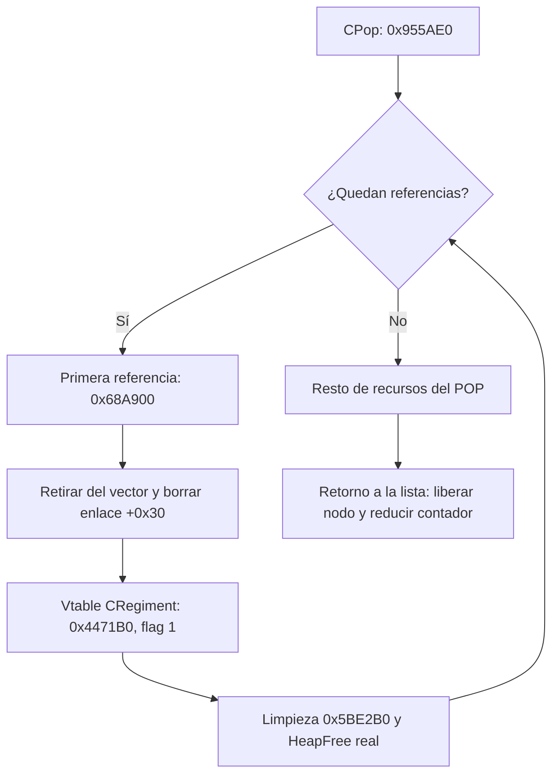

# Referencias de POP y destrucción de regimientos

Perfil `base-game/v2game.exe`, SHA-256
`62d48c204364dd706584777c2e2b3c7ab3c5f1dd0170872554943575d53d6648`.
Las VA de esta nota usan base preferida `0x00400000`. El banco nativo usa base real
`0x30000000`: sumar `0x2FC00000` a cada VA preferida.

## Enlace entre código y clases

**confirmed, nombres y enlaces RTTI:** TypeDescriptor `0x00F107F4` nombra
`.?AVCRegiment@@`. Su locator `0x00E4B3E4` enlaza con ese descriptor y la jerarquía
`0x00E4B3F8`. La palabra anterior a la vtable `0x00DF8884` apunta al locator; su primer
slot es `0x004471B0`. La jerarquía incluye `CSubUnit`, `CReferenceObject` y `CPersistent`.
La vtable `0x00E029EC` está vinculada por el mismo formato a `CSubUnit`.

El wrapper `0x004471B0` pasa `this` por ECX a `0x005BE2B0`, comprueba el bit 0 de su
argumento y llama al wrapper de liberación si está activo. Durante la limpieza,
`0x005BE2B0` escribe la vtable CSubUnit y finalmente `0x00E3A544`. Esta última tabla
sigue sin atribución de clase por el mismo procedimiento.

**confirmed, instrucciones:** el destructor de POP `0x00955AE0` consulta el rango
`POP+0x3C..POP+0x40`; mientras no esté vacío, entrega su primer puntero a `0x0068A900`.
Esta entrada puede llamar a `0x004BE200` sobre `objeto+0x30+0x3C`, pone `objeto+0x30`
a cero y termina llamando al primer slot virtual del objeto con argumento uno.
El destructor de CRegiment también retira su referencia de ese vector si todavía
conserva `+0x30` distinto de cero.

**inferred:** el vector del POP contiene referencias a regimientos y `regimiento+0x30`
es su enlace al POP. La interpretación se apoya en el circuito bidireccional de
limpieza y las vtables. El banco prueba ese circuito con fixtures tipados por vtable;
no demuestra que todas las instancias de ese vector tengan ese tipo en una partida.
Se retira el nombre provisional «observadores» usado antes de investigar los destinos.

Flujo comprobado por el banco con las ramas globales excluidas:



## Ruta de eliminación y efectos compartidos

La entrada `0x0068A900` recibe contexto en EAX y el objeto por argumento de pila,
terminando mediante `RET 4`. La lectura estática muestra ramas adicionales:

| Condición | Efecto candidato o llamada observada |
| --- | --- |
| EAX no nulo y estado global `+0xD1D=0` | Llama a `0x005C5090` con un índice de 16 bits y datos de `objeto+0x38` |
| `objeto+0x30` no nulo, estado `+0xD1C!=0`, bytes `+0x60` iguales a `REB` | Modifica el entero de 64 bits de `POP+0x120`, usando el divisor global y el helper `0x00AC02A0` |
| `objeto+0x30` no nulo | Busca y retira la primera referencia con `0x004BE200`, después borra el enlace |
| `objeto+0x74` no nulo | Puede emitir dos llamadas virtuales en slot `+0x34` y llama a `0x005CB230` |
| Siempre al final, si el flujo alcanza ese punto | Primer slot virtual con flag uno |

Las interpretaciones «país/tipo», «ejército» y `REB` son nombres de trabajo para las
ramas excluidas; sus contratos completos todavía no están demostrados. La presencia de
escrituras fuera del POP impide tratar esta rutina como cálculo independiente sin
investigar esas dependencias. Tampoco demuestra por sí sola una carrera en el juego.

## Validación actual y límites

**confirmed en el dominio nativo declarado:** con estado `+0xD1D=1`, `+0xD1C=0`,
`regimiento+0x74=0`, cadenas internas y registros ausentes, la cadena completa ejecuta
`0x0068A900`, el borrado del vector, el wrapper virtual CRegiment, su destructor y
HeapFree real. Para vectores de dos o tres elementos alcanza también `0x0068F020` y
`0x00AAE480`, que desplaza las referencias restantes. No se sustituyen esos cuerpos
por stubs. Se comparan los regimientos antes de liberar y el vector completo al final.

El [banco nativo](NATIVE-POP.md) detalla los 134 casos combinados, hashes, 632
liberaciones y 192 snapshots. La validación RTTI añadió siete comprobaciones de bytes
y enlaces y once de instrucciones: 39 checks RTTI en total. Reproducción desde la
raíz con `research/env.sh` cargado:

```bash
python research/scripts/inventory_rtti.py
python research/scripts/build_native_pop_probe.py
python research/scripts/run_native_pop_probe.py
```

Quedan abiertos los constructores y escritores de estos enlaces, los contratos de las
ramas excluidas, el registro vivo, las eliminaciones directas desde otros llamadores
y las posibles clases derivadas presentes en el mundo real. No se atribuye pureza,
seguridad multinúcleo ni una mejora medida del tick.
